# Unlock My World

마법의 황금 자물쇠를 열고 들어가는 **인터랙티브 3D 전시관** 형태의 개인 포트폴리오 웹사이트입니다.
크몽 외주 포트폴리오와 UX/UI 취업용 포트폴리오로 함께 사용합니다.

## 콘셉트

- 크림 · 라벤더 · 샴페인 골드 컬러
- 아치형 건축 구조와 공중에 떠 있는 3D 전시 오브젝트
- 게임이 아닌, 고급스럽고 시네마틱한 디자인 전시 경험
- 스크롤 기반 카메라 이동과 정교한 인터랙션

## 전시 프로젝트

| # | 프로젝트 | 전시 오브젝트 |
|---|----------|---------------|
| 1 | 공연 좌석 교환 UX | 황금 티켓 |
| 2 | 회원가입 UX 리디자인 | 3D 스마트폰 |
| 3 | 개인 웹 프로토타입 | 입체 브라우저 |

## 미리보기

| 데스크톱 | 모바일 |
|---|---|
| 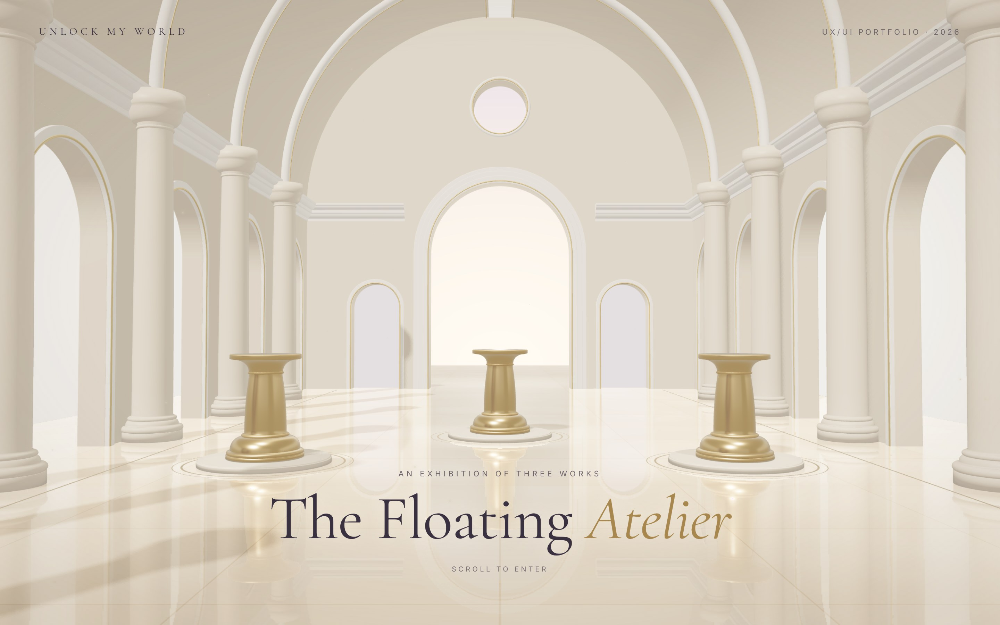 | 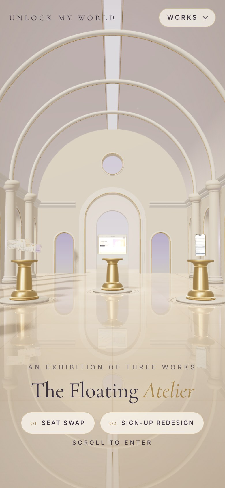 |

### 작품 3 — Web Prototype (근접 촬영, 데모 화면)

기본 → hover(레이어가 살짝 떠오름) → 클릭(브라우저가 돌아서며 UI 레이어가 공간으로 펼쳐짐). 다시 클릭하면 조립됩니다.

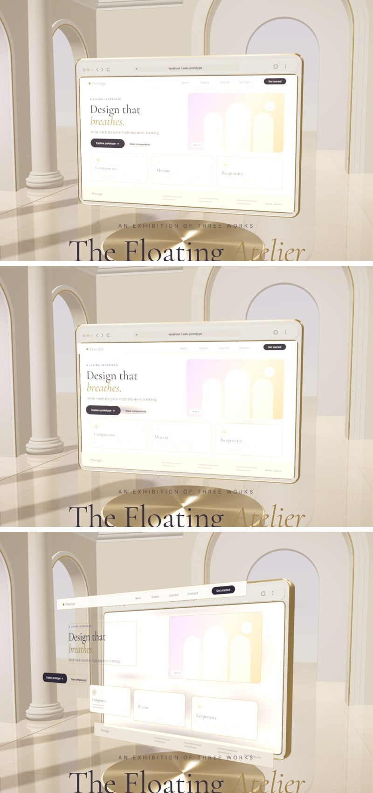

### 작품 바로가기 — Works 내비게이션 · 3D 오브젝트 클릭

| 데스크톱 (상단 Works 메뉴, 3D 작품 hover 안내) | 모바일 (바로가기 · Works 메뉴 · Back to Gallery) |
|---|---|
| 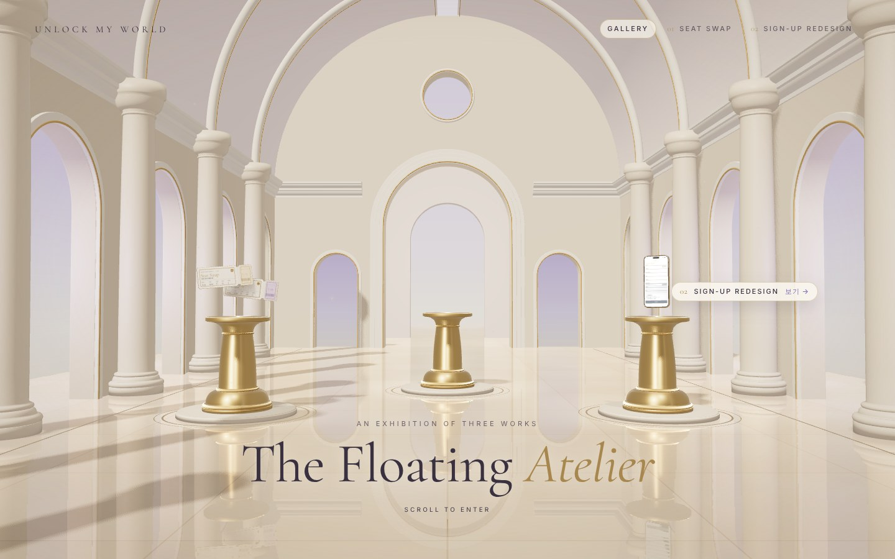 | 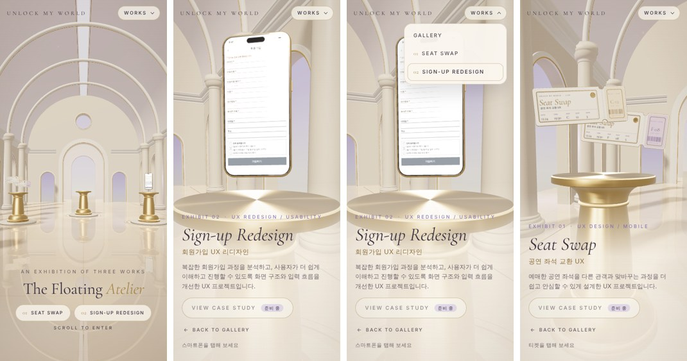 |

### 작품 2 — Sign-up Redesign (근접 촬영)

기존 화면 → UI 요소가 화면 위로 떠오르며 분리 → 개선된 화면으로 정렬 (화면 내용은 임시 데모)

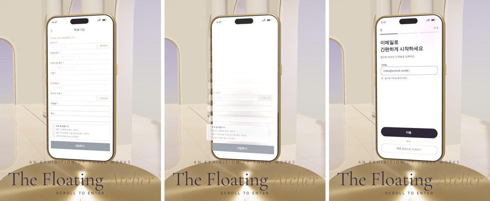

### 스크롤 투어 — 작품 근접 화면

아래로 스크롤하면 카메라가 전시관 전체 → Seat Swap → Sign-up Redesign → Web Prototype 순서로 이동하고, 각 작품 앞에서 프로젝트 소개가 나타납니다.

| | 데스크톱 | 모바일 |
|---|---|---|
| Exhibit 01 | 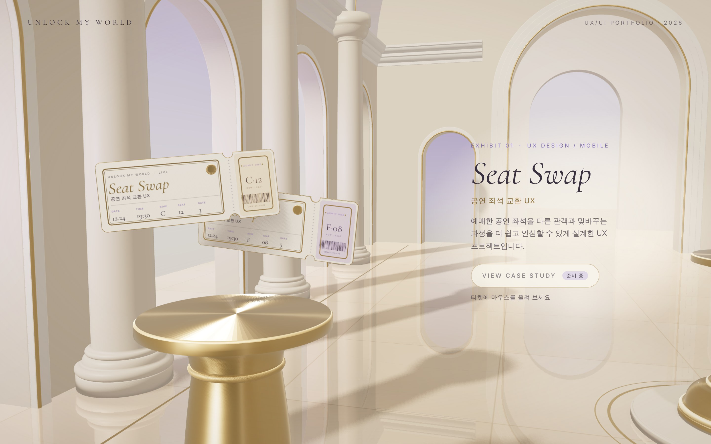 | 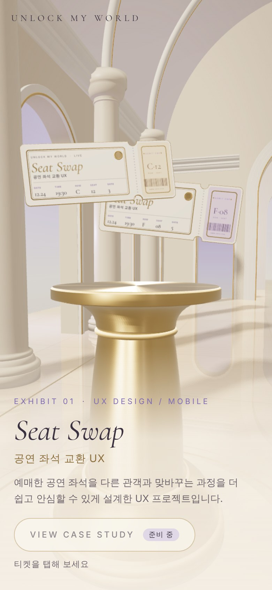 |
| Exhibit 02 | 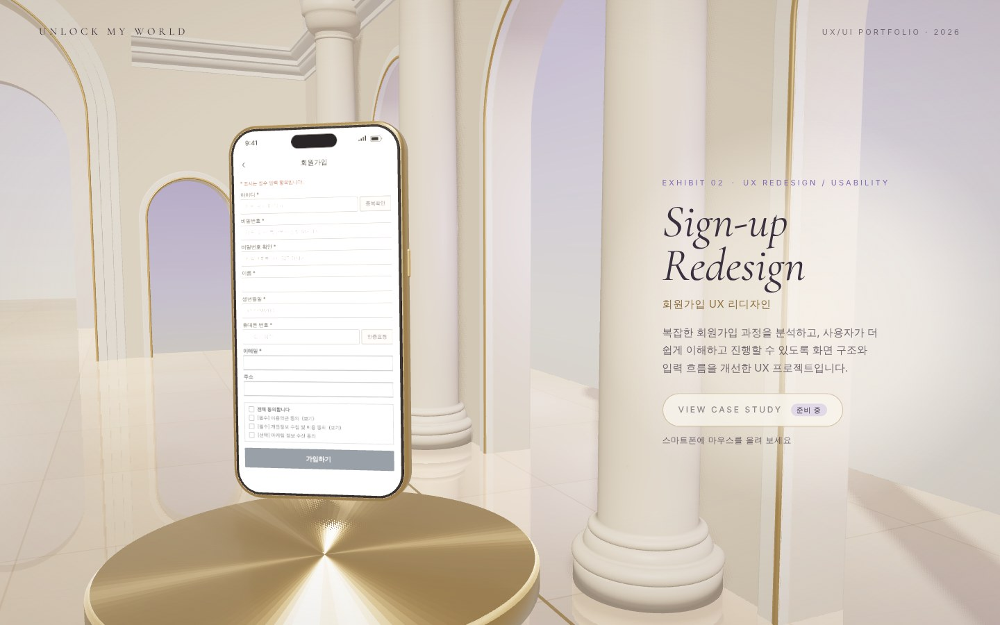 | 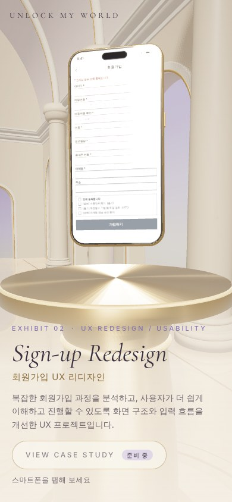 |
| Exhibit 03 | 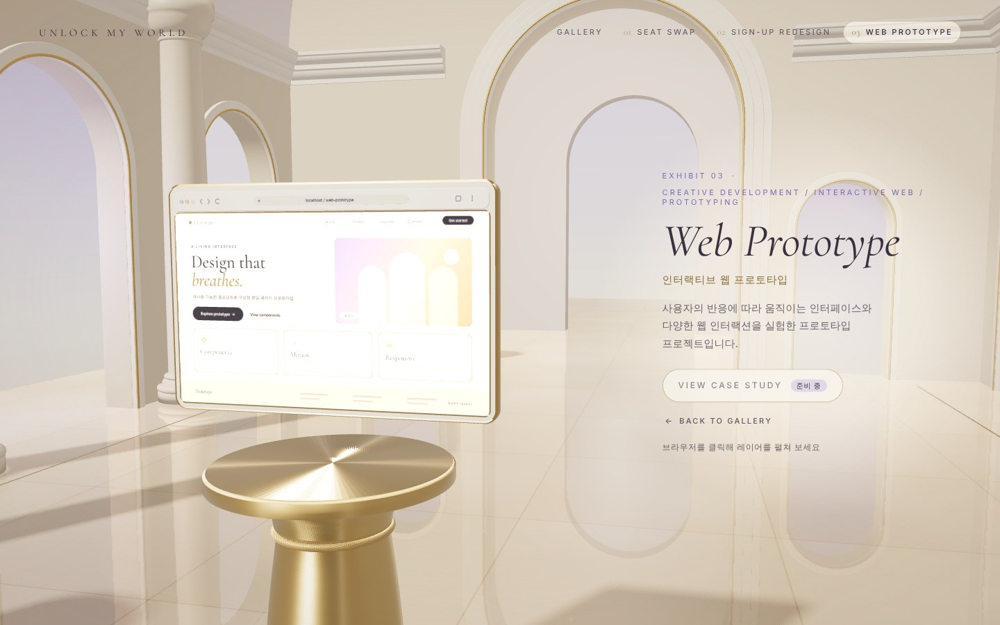 | 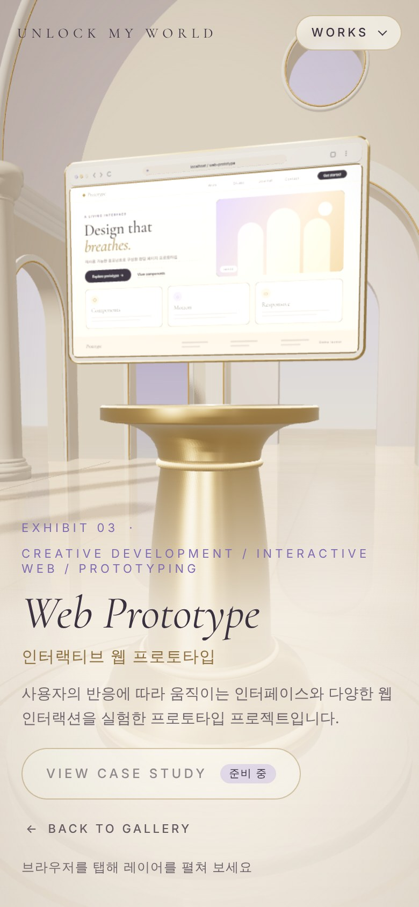 |

### 작품 1 — Seat Swap (근접 촬영)

| 기본 상태 | 마우스 오버 — 좌석 교환 중 |
|---|---|
| 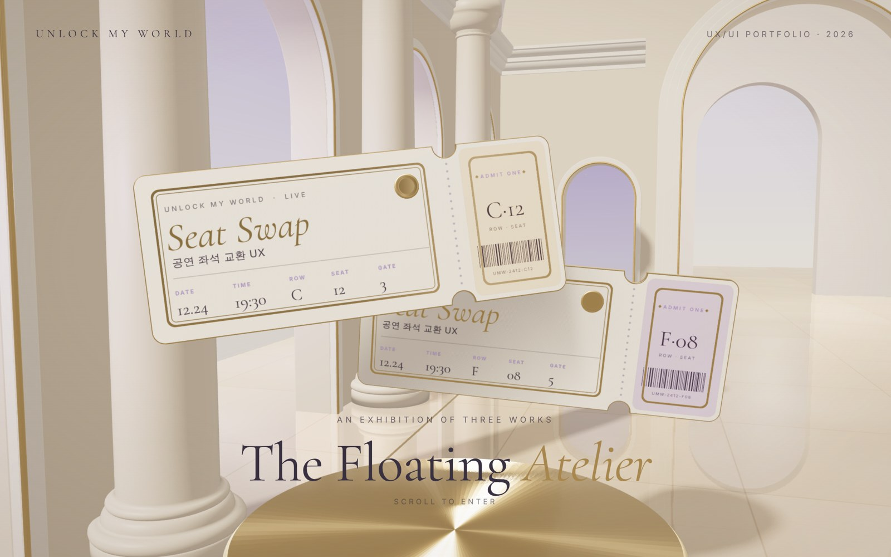 | 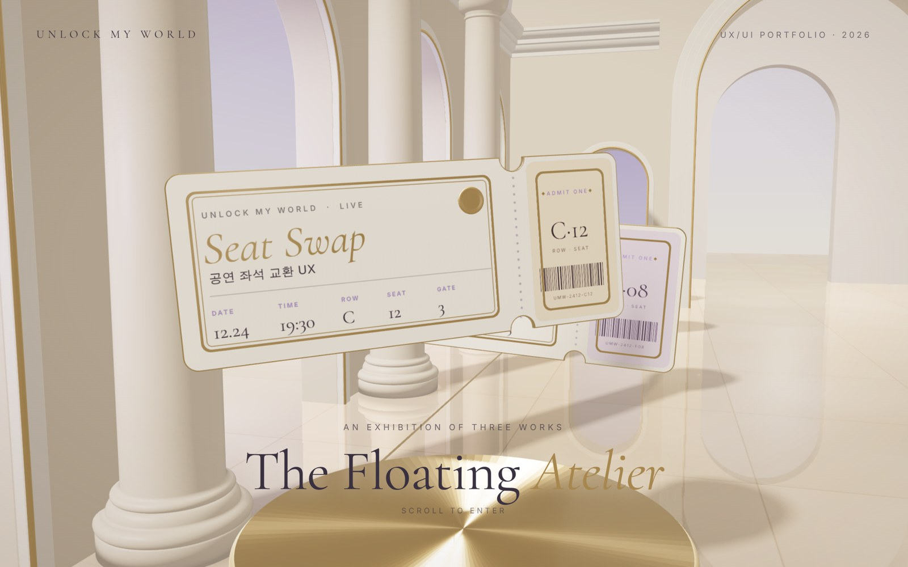 |

## 개발 환경

- **React + Vite + TypeScript**
- **React Three Fiber + Three.js + Drei** — 3D 장면
- **GSAP + ScrollTrigger** (`@gsap/react`) — 스크롤 기반 애니메이션
- **CSS** 기반 반응형 UI
- Node.js 20.19+ (또는 22.12+) 권장

## 시작하기

```bash
npm install
npm run dev      # 개발 서버 (http://localhost:5173)
npm run build    # 프로덕션 빌드 (dist/)
npm run preview  # 빌드 결과 미리보기
npm run lint     # 코드 검사 (oxlint)
```

## 폴더 구조

```
public/
  models/       3D 모델 (glb/gltf)
  textures/     텍스처 이미지
src/
  components/   공통 UI 컴포넌트
  scenes/       React Three Fiber 3D 장면·오브젝트
  sections/     페이지 섹션 (스크롤 구간)
  hooks/        커스텀 훅
  lib/          설정·유틸 (gsap.ts: GSAP 플러그인 등록)
  data/         프로젝트 콘텐츠 데이터
  styles/       전역 스타일과 디자인 토큰
  types/        공용 타입
```

### 3D 장면 구성 (`src/scenes/atelier/`)

| 파일 | 역할 |
|---|---|
| `constants.ts` | 공간 치수(m)·팔레트·전시대 배치 |
| `geometry.ts` | 아치 벽·아키볼트·몰딩 프로파일(Lathe) 생성 헬퍼 |
| `materials.ts` | 공유 머티리얼 (미장 벽, 크림 스톤, 샴페인 골드 등) |
| `Architecture.tsx` | 아치 아케이드 측벽, 기둥, 리브 볼트 천장, 대형 포털·오큘러스 |
| `Floor.tsx` | 반사 대리석 바닥(절차적 텍스처) + 금색 상감선 |
| `Pedestals.tsx` | 샴페인 골드 전시대 3개 |
| `Lighting.tsx` | 주광(그림자), 스포트라이트, Lightformer 환경맵 |
| `Atmosphere.tsx` | 포털 너머 빛 배경, 금빛 입자 |
| `CameraRig.tsx` | 반응형 화각 + 스크롤 투어 카메라 이동 + 마우스 패럴랙스 합성 |
| `exhibits/layout.ts` | 작품 배치·크기 (근접 구도 계산에 공유) |
| `exhibits/SeatSwapExhibit.tsx` | 작품 1: 떠 있는 두 티켓, hover/탭 시 좌석 교환 애니메이션 |
| `exhibits/Ticket.tsx` | 노치·두께·금박 모서리·금박 테두리/인장을 가진 입체 티켓 |
| `exhibits/ticketArt.ts` | 티켓 인쇄면(잉크·금박·뒷면 무늬) 캔버스 텍스처 |
| `exhibits/SignupExhibit.tsx` | 작품 2: 떠 있는 스마트폰, hover/탭 시 UI 레이어 분리 → 개선 화면 정렬 |
| `exhibits/Phone.tsx`, `phoneGeometry.ts` | 금속 프레임·후면 유리·베젤·전면 유리·카메라 모듈을 가진 3D 스마트폰 |
| `exhibits/signupScreens.ts` | 기존/개선 회원가입 데모 화면 (요소별 캔버스 텍스처) |
| `exhibits/WebPrototypeExhibit.tsx` | 작품 3: 떠 있는 브라우저, hover 시 레이어 깊이감, 클릭/탭으로 레이어 펼치기·조립 |
| `exhibits/Browser.tsx`, `browserGeometry.ts` | 금속 측면·툴바·주소창·화면 테두리·유리를 가진 3D 브라우저 (화면 콘텐츠는 children) |
| `exhibits/webPrototypeScreen.ts` | 데모 웹페이지 레이어와 레이어별 펼침 깊이·방향 — 실제 작업물로 바꿀 때 이 파일만 교체 |
| `exhibits/shapes.ts`, `uiCanvas.ts` | 공용 둥근 사각 형상 / 캔버스 텍스처·카드 그림자 헬퍼 |
| `exhibits/useExhibitInteraction.ts` | 작품 공통 인터랙션 (hover / 탭 / 클릭 토글 / 작품 앞이 아닐 때 이동) |

외부 3D 모델·HDRI 없이 모두 코드로 생성합니다.

### 스크롤 투어 구조

- `src/sections/ScrollTour.tsx` — 실제 스크롤 트랙 + GSAP ScrollTrigger 타임라인. 작품마다 '이동 → 감상' 구간을 두고, 투어 위치(0 = 전체, 1 = 작품 1, 2 = 작품 2)를 `src/lib/tour.ts` 의 공유 객체에 기록합니다. 메인 제목과 작품별 패널의 전환도 같은 값으로 제어합니다.
- 스냅은 감상 구간 바로 근처에서 멈췄을 때만 부드럽게 맞춰 주고, 그 외에는 멈춘 자리를 그대로 둡니다.
- 투어 순서는 `TOUR_PROJECT_IDS`(tour.ts)와 `TOUR_EXHIBITS`(exhibits/layout.ts) — 작품별 근접 구도는 `framing`(화면 위치·비율)으로 정의합니다.
- `CameraRig` 가 매 프레임 투어 위치를 읽어 정류장 구도 사이의 위치와 시선을 함께 보간합니다.
- `src/sections/ExhibitPanel.tsx` — 프로젝트 소개 패널. `projects.ts` 의 `caseStudyUrl` 이 있으면 링크, 없으면 '준비 중' 비활성 버튼으로 표시됩니다.
- 애니메이션 감소 설정에서는 이동 과정 없이 두 화면이 바로 전환됩니다.

### 직접 이동 (작품 클릭 · Works 메뉴 · Back to Gallery · Esc)

탐색 상태는 하나(스크롤 위치)로 통합되어 있습니다. `goToStop(n)`(`src/lib/tour.ts`)을 호출하면:

1. 스크롤 위치를 목표 작품의 감상 구간으로 즉시 맞춥니다 → 투어 진행도도 목표와 일치
2. 카메라만 현재 구도에서 목표 구도로 곧장 비행합니다 (중간 작품을 거치지 않음, `tour.flight`)
3. 비행이 끝나면 진행도가 이미 목표와 같으므로 점프 없이 스크롤 투어로 이어집니다
4. 비행 중에 스크롤을 시작하면 비행을 멈추고 그 자리에서 스크롤로 넘어갑니다

- 3D 작품: 작품 앞이 아닐 때는 클릭/탭 = 이동, 작품 앞에서만 hover/탭 = 작품 애니메이션 (`useExhibitInteraction`)
- Web Prototype: 작품 앞에서 hover = 가벼운 깊이감, 클릭/탭 = 레이어 펼치기·조립. 펼친 상태는 같은 방문 동안만 유지되고, 다른 작품으로 떠나면 조립된 상태로 돌아옵니다
- 키보드: Works 메뉴는 Tab·화살표·Home/End·Enter, 좁은 화면 메뉴는 Esc 로 닫기, 작품 화면에서 Esc = 전시관으로. 이동 후 해당 화면 제목으로 포커스 이동
- 새 작품 추가: `projects.ts` 데이터 + `TOUR_PROJECT_IDS` + `EXHIBIT_LAYOUT` 에 한 줄씩 — 메뉴·패널·카메라 구도·스크롤 구간이 자동으로 늘어납니다

`@/` 경로 별칭은 `src/`를 가리킵니다. (예: `import { projects } from '@/data/projects'`)

## 진행 상태

- [x] 프로젝트 초기 설정
- [x] STEP 2 — 3D 전시관 첫 장면 (The Floating Atelier)
- [x] STEP 3 — 작품 1: Seat Swap (공연 좌석 교환 UX)
- [x] STEP 3-1 — 스크롤 카메라 투어 (Seat Swap 근접 화면)
- [x] STEP 4 — 작품 2: Sign-up Redesign (3D 스마트폰, 데모 화면)
- [x] STEP 4-1 — 스크롤 투어 확장 (전체 → Seat Swap → Sign-up Redesign)
- [x] 자유 탐색 — 3D 작품 클릭, Works 메뉴, Back to Gallery, 키보드
- [x] STEP 7 — 작품 3: Web Prototype (3D 브라우저, UI 레이어 확장 · 데모 화면, 스크롤 투어 연결 전)
- [x] STEP 7-1 — Web Prototype 스크롤 투어·Works 메뉴·직접 이동 연결
- [ ] 황금 자물쇠 인트로
- [ ] 스크롤 카메라 연출 · 인터랙션
