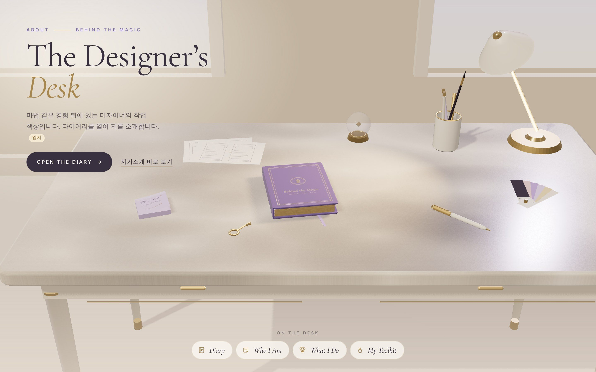
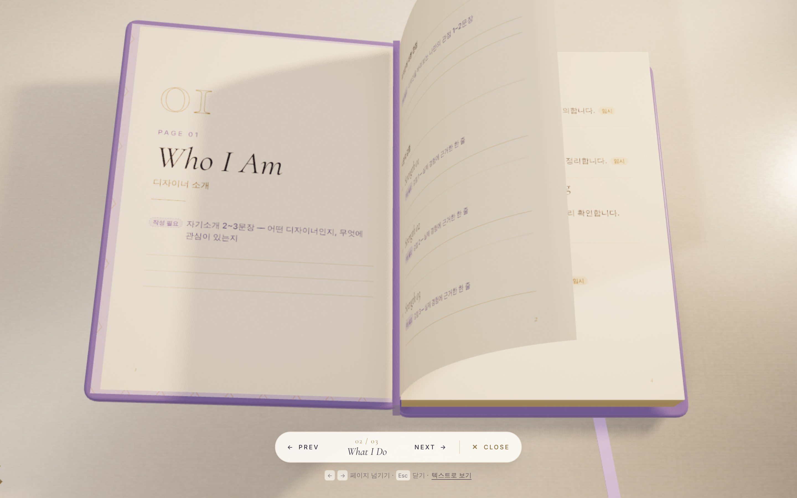
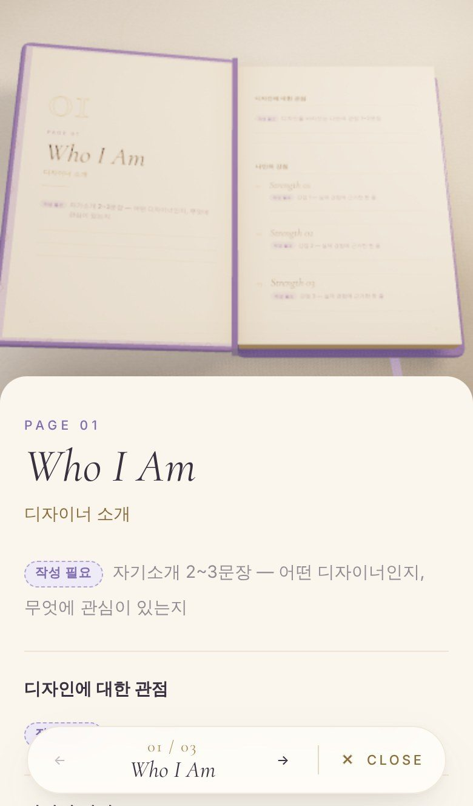

# About — Behind the Magic / The Designer's Desk

마법적인 아틀리에에 놓인 **디자이너의 작업 책상**입니다. 책상 위 물건이 실제 인터페이스로 동작하고,
다이어리를 펼치면 자기소개가 나타납니다. 전시관 코드(`App.tsx`, `scenes/`, `sections/`, `styles/`)와
분리된 독립 모듈입니다.

| 책상 구도 | 다이어리 펼침 | 모바일 |
|---|---|---|
|  |  |  |

여닫기 영상: [`docs/about/diary-open-close.mp4`](../../docs/about/diary-open-close.mp4)

## 미리보기

```bash
npm run dev
# http://localhost:5173/about-preview.html
```

미리보기 페이지까지 포함한 빌드 (기존 `vite.config.ts` 수정 없음):

```bash
npx vite build --config vite.about.config.ts   # dist/about-preview.html
```

## 경험 구성

| 대상 | 기본 | 호버 / 포커스 | 클릭 |
|---|---|---|---|
| 다이어리 | 금박 테두리에 6초마다 빛이 흐름 | 살짝 들리고 금박에 빛이 계속 흐름 | 카메라 접근 → 표지 회전 → 낱장 두 장 넘김 → 첫 펼침면 |
| 라벤더 메모 | — | 들림 + 이름표 | 다이어리를 *Who I Am* 으로 펼침 |
| 컬러 스와치 | — | 들림 + 이름표 | *What I Do* 로 펼침 |
| 펜꽂이 | — | 들림 + 이름표 | *My Toolkit* 으로 펼침 |

펼친 상태: 오른쪽 페이지 클릭 / `→` / Next = 다음 장, 왼쪽 페이지 / `←` / Prev = 이전 장, `Esc` / Close = 닫기.
닫으면 펼친 낱장을 먼저 되돌린 뒤 표지를 닫고 책상 구도로 돌아갑니다.

### 접근성 · 반응형

- **소개 글과 버튼이 항상 보임** — 다이어리를 열지 않아도 About 섹션임을 알 수 있음
- **자기소개 바로 보기** — 3D 없이 전체 내용을 HTML 텍스트로 (WebGL 미지원 환경에서는 자동 표시)
- **책상 위 물건 버튼** — 3D 소품을 정확히 겨누지 않아도 같은 동작. 포커스하면 3D 소품도 강조
- 키보드만으로 열기 · 넘기기 · 닫기 가능, 열면 페이지 제목으로 / 닫으면 열기 버튼으로 포커스 이동
- 넓은 화면: 3D 페이지가 내용을 보여주고, 같은 내용을 스크린 리더용으로 제공
- 좁은 화면(폭 760px 이하 또는 세로 화면): 3D 다이어리는 위, **HTML 읽기 시트**가 아래 — 작은 3D 글자를 읽을 필요 없음
- `prefers-reduced-motion`: 카메라 이동 · 표지 · 넘김 애니메이션 없이 바로 펼친 상태로 전환, 반짝임 없음
- 화면 밖에서는 3D 렌더링 정지, three.js 장면은 별도 청크로 지연 로딩

## 콘텐츠 수정

모든 텍스트는 `data/aboutContent.ts` 한 파일에 있습니다. 다이어리 3D 페이지(캔버스 텍스처),
모바일 읽기 시트, 텍스트 보기가 모두 이 데이터에서 그려집니다.

```ts
'확정된 실제 내용'               // 그대로 표시
draft('방향을 보여주는 임시 문구')  // '임시' 배지
pending('써야 할 내용 안내')        // '작성 필요' 배지 + 다이어리에는 빈 필기 줄
```

현재는 섹션 제목과 항목 이름(UX Research, Figma 등)만 확정 문자열이고,
자기소개 · 관점 · 강점 · 도구 활용 방식은 모두 `pending()` 입니다. 경력 · 능숙도 · 성과는 넣지 않았습니다.
3D 페이지 공간에 맞도록 문단은 3~4문장 이내를 권장합니다.

## 폴더 구조

```
src/about/
  index.ts                공개 API — 메인 앱은 여기서만 import
  AboutSection.tsx        섹션 (상태 · 키보드 · 포커스 · 레이아웃)
  types.ts                콘텐츠 스키마 + draft() / pending()
  data/aboutContent.ts    자기소개 콘텐츠
  scene/
    DeskCanvas.tsx        R3F 캔버스 · 장면 구성
    Diary.tsx             3D 다이어리 (표지 힌지, 휘어지며 넘어가는 낱장, 금박 셰이더, 여닫기 타임라인)
    diaryGeometry.ts      낱장 곡면 변형 · 하드커버 판 · 둥근 상판 지오메트리
    diaryAnim.ts          다이어리 ↔ 카메라 공유 타임라인
    pageArt.ts            콘텐츠 → 페이지 캔버스 텍스처, 표지 금박 맵
    CameraDirector.tsx    책상 구도 ↔ 다이어리 근접 구도, 미세 패럴랙스
    DeskLighting.tsx      창가 주광 · 라벤더 역광 · Lightformer 환경맵
    Desk.tsx              책상 · 방 (아치 창)
    props/Props.tsx       골드 펜, 라벤더 메모, 스와치, 펜꽂이, 램프, 스케치, 유리 문진, 열쇠
    Interactive.tsx       소품 호버 · 클릭 래퍼
    materials.ts / textures.ts / propArt.ts / layout.ts
  ui/                     DiaryReader, DeskNav, AboutTextView, PageContent, AboutTextValue
  hooks/useAboutEnv.ts    화면 진입 감지, WebGL 지원 확인
  styles/about.css        .ab-root 범위 스타일 (전역 CSS 변경 없음)
  preview/                독립 미리보기 진입점
```

외부 3D 모델 · 이미지 없이 모두 코드(지오메트리 + 캔버스 텍스처)로 만듭니다.

## 메인 앱 통합

```tsx
import { AboutSection } from '@/about'

// 전시관 스크롤 투어 뒤, 또는 원하는 위치에
<AboutSection id="about" />
```

- 자체 CSS 를 import 하며 모든 스타일이 `.ab-root` 안에 한정됩니다.
- `@/hooks/useMediaQuery` (기존 훅)만 읽기 전용으로 사용합니다.
- 전시관 캔버스와 별도의 WebGL 컨텍스트를 씁니다. About 이 화면 밖이면 렌더링을 멈추므로 두 캔버스가
  동시에 계속 그려지지 않습니다. 하나의 캔버스로 합치고 싶다면 `scene/` 의 컴포넌트를 전시관 장면에 넣고
  `CameraDirector` 대신 전시관 카메라 리그에서 `DiaryAnim.cam` 값을 읽으면 됩니다.
- 내비게이션에서 `#about` 으로 연결하면 됩니다.
