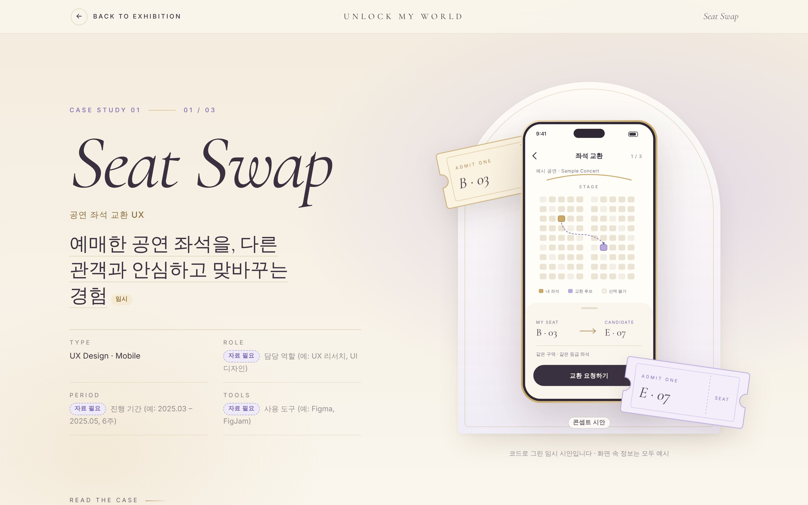
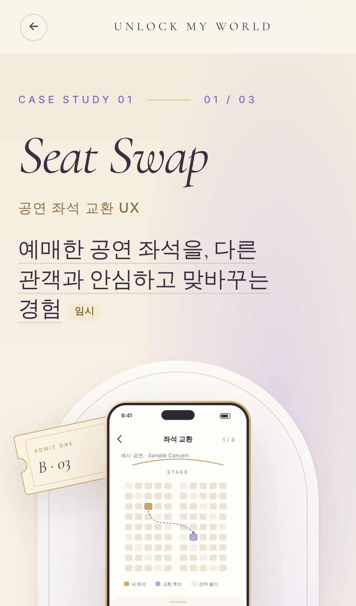

# Case Studies — 프로젝트 상세 페이지

Unlock My World 전시관의 각 작품에서 이어지는 **UX/UI 케이스 스터디 상세 페이지** 모듈입니다.
전시관 코드(`App.tsx`, `scenes/`, `sections/`, `styles/`)와 완전히 분리되어 있고, 데이터만 바꾸면
어떤 프로젝트든 같은 구조로 그려집니다.

| 데스크톱 | 모바일 |
|---|---|
|  |  |

## 미리보기

```bash
npm run dev
# http://localhost:5173/case-study-preview.html?project=seat-swap
# http://localhost:5173/case-study-preview.html?project=signup-redesign
# http://localhost:5173/case-study-preview.html?project=web-prototype
```

미리보기 페이지까지 포함한 빌드 (기존 `vite.config.ts` 는 수정하지 않음):

```bash
npx vite build --config vite.case-study.config.ts   # dist/case-study-preview.html
```

## 페이지 구조

모든 프로젝트가 같은 순서를 사용합니다 (`types.ts` 의 `SECTION_ORDER`).

1. **Hero** — 프로젝트명 · 한 줄 소개 · 대표 목업 · 유형 / 역할 / 기간 / 도구
2. **Overview** — 배경 · 작업 범위 · 핵심 목표
3. **Problem** — 불편함 · 문제 정의
4. **Research** — 조사 자료 · 인사이트 · 사용자 흐름과 페인포인트
5. **Design Solution** — 정보 구조 · User Flow · Wireframe · UI · 인터랙션
6. **Prototype** — 최종 UI · Live Demo / 프로토타입 링크
7. **Reflection** — 배운 점 · 한계와 개선 방향

UX 기능: Back to Exhibition, 이전/다음 프로젝트, 목차(넓은 화면 왼쪽 고정 / 좁은 화면 상단 펼침),
현재 섹션 표시, 읽기 진행선, 맨 위로, 본문 건너뛰기 링크, 키보드 포커스 이동, `prefers-reduced-motion` 대응,
이미지 지연 로딩·스켈레톤·오류 대체 화면.

## 폴더 구조

```
src/case-studies/
  index.ts                공개 API — 메인 앱은 여기서만 import
  types.ts                데이터 스키마 + draft() / pending() 헬퍼
  sections.ts             섹션 제목·라벨, DOM id 규칙
  routing.ts              독립 페이지용 주소 규칙 (?project=…)
  CaseStudyApp.tsx        라우터 없이 동작하는 단독 앱 (미리보기용)
  data/
    index.ts              레지스트리 (projects.ts 와 병합, 이전/다음 계산)
    template.ts           모든 섹션이 '자료 필요' 상태인 빈 템플릿
    seat-swap.ts          Seat Swap (예시 — 완성도 높은 템플릿 적용)
    signup-redesign.ts    Sign-up Redesign (구조만 적용)
    web-prototype.ts      Web Prototype (구조만 적용)
  components/
    CaseStudyPage.tsx     페이지 조립 (라우터 비의존)
    TopBar.tsx            상단 고정 바 + 읽기 진행선
    Hero.tsx              히어로 (아치 프레임 + 미세한 3D 기울기)
    TableOfContents.tsx   목차 + 현재 섹션 표시
    Section.tsx           공통 섹션 틀
    blocks/Blocks.tsx     콘텐츠 블록 렌더러 (prose, list, facts, cards, statement, flow, media, gallery, links)
    Media.tsx             이미지 / 콘셉트 시안 / 플레이스홀더
    ProjectPager.tsx      이전 · 다음 프로젝트
    BackToTop.tsx         맨 위로
    Reveal.tsx            등장 애니메이션 래퍼
    Text.tsx              임시 · 자료 필요 표시가 붙는 텍스트
  hooks/
    useScrollSpy.ts       현재 섹션 · 진행률 계산
    useReveal.ts          화면 진입 감지
  illustrations/          코드로 그린 콘셉트 시안 (실제 디자인 아님)
  styles/
    tokens.css            .cs-root 범위의 디자인 토큰
    case-study.css        컴포넌트 스타일 (모든 클래스 cs- 접두사)
  preview/                독립 미리보기 진입점
```

## 콘텐츠 작성 규칙 — 임시 콘텐츠 표시

실제 자료가 없는 내용을 사실처럼 보이지 않게 하기 위해 텍스트 값은 세 가지 중 하나입니다.

```ts
'실제 확정 내용'                     // 그대로 표시
draft('방향을 보여주는 임시 문구')    // 문장 뒤에 '임시' 배지
pending('넣어야 할 자료 안내')        // '자료 필요' 배지 + 안내문
```

- 이미지가 없으면 `media.placeholder` 에 넣을 자료를 적습니다 → 빗금 플레이스홀더로 표시
- 코드로 그린 목업은 `status: 'concept'` 필수 → '콘셉트 시안' 배지와 안내 캡션 표시
- 링크 `href` 가 없으면 버튼은 비활성 '준비 중' 상태
- `status: 'draft'` 인 프로젝트는 페이지 상단에 'Template Preview' 안내가 나타납니다

실제 자료가 들어오면 `draft()` / `pending()` 을 일반 문자열로, `illustration` 을 `image` 로 교체하고
모든 자료가 채워지면 `status: 'published'` 로 바꾸세요.

```ts
// 실제 이미지 — 여러 해상도를 주면 srcset 으로 반응형 로딩
item: {
  image: { sources: [{ src: '/case-studies/seat-swap/ui@1x.webp', width: 1200 },
                     { src: '/case-studies/seat-swap/ui@2x.webp', width: 2400 }] },
  alt: '좌석 교환 최종 UI',
  aspect: '16 / 10',
}
```

## 프로젝트 추가 (4번째, 5번째…)

1. `src/data/projects.ts` 에 프로젝트 추가 (전시관과 공유하는 id · 제목 · 부제 · 번호)
2. `src/case-studies/data/new-project.ts` 생성 — `createBlankSections()` 로 시작
3. `src/case-studies/data/index.ts` 의 `registry` 배열에 추가

컴포넌트·스타일은 수정할 필요가 없습니다. 목차·번호·이전/다음은 자동으로 계산됩니다.

## 메인 앱 통합

### A. 별도 페이지로 연결 (가장 간단, 충돌 최소)

`src/data/projects.ts` 의 `caseStudyUrl` 만 채우면 전시관의 'View Case Study' 버튼이 활성화됩니다.

```ts
caseStudyUrl: '/case-study-preview.html?project=seat-swap'
```

배포 빌드에 페이지를 포함하려면 `vite.config.ts` 의 `build.rolldownOptions.input` 에
`case-study-preview.html` 을 추가하거나(= `vite.case-study.config.ts` 내용 병합),
파일 이름을 `case-study.html` 등으로 바꿔 사용하세요.

### B. 메인 앱 안에서 렌더링 (라우터 사용 시)

```tsx
import { CaseStudyPage, caseStudies, getAdjacentCaseStudies, getCaseStudy } from '@/case-studies'

function CaseStudyRoute({ id }: { id: string }) {
  const study = getCaseStudy(id)
  if (!study) return <NotFound />
  const { prev, next } = getAdjacentCaseStudies(id)
  return (
    <CaseStudyPage
      study={study}
      total={caseStudies.length}
      prev={prev}
      next={next}
      exhibitionHref="/#exhibit-seat-swap"
      getProjectHref={(pid) => `/work/${pid}`}
      onNavigateProject={(pid, e) => { e.preventDefault(); navigate(`/work/${pid}`) }}
    />
  )
}
```

- `CaseStudyPage` 는 자체 CSS 를 import 하며, 모든 스타일이 `.cs-root` 안에 한정되어 전시관 스타일과 섞이지 않습니다.
- 전시관의 `global.css` 가 `body` 배경을 크림색으로 지정하므로 별도 설정이 필요 없습니다.
- 폰트: Cormorant Garamond 400 / 400 italic 은 메인 앱에서 이미 로드됩니다. 500 웨이트는 선택 사항입니다.
