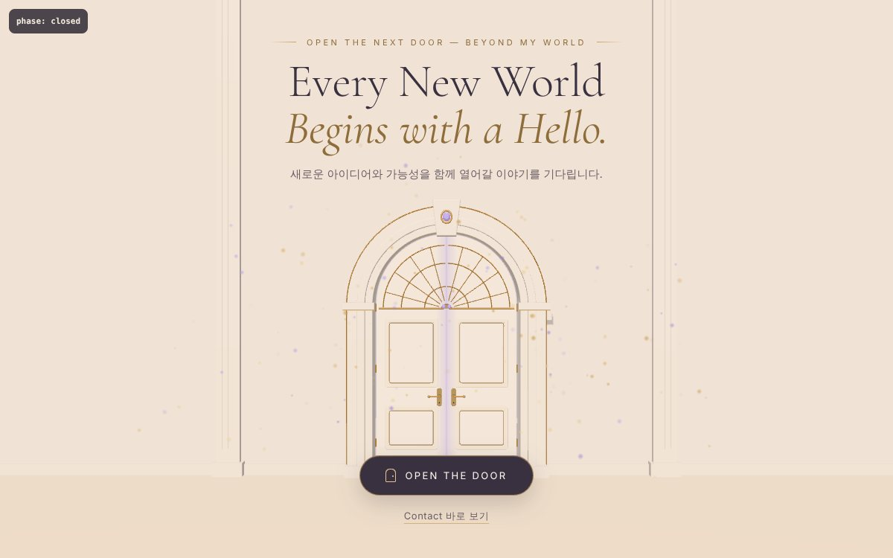
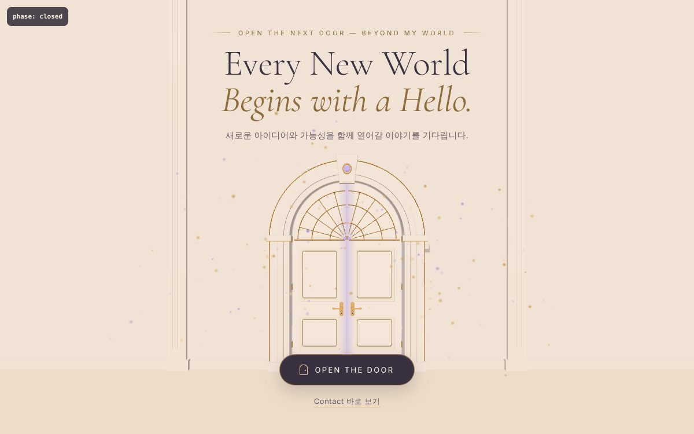
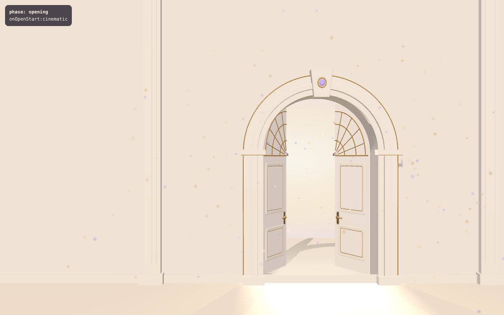
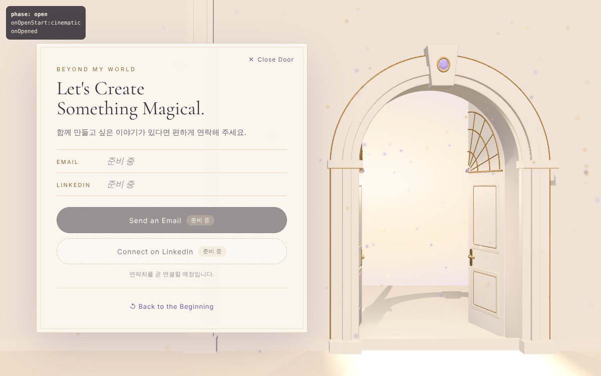
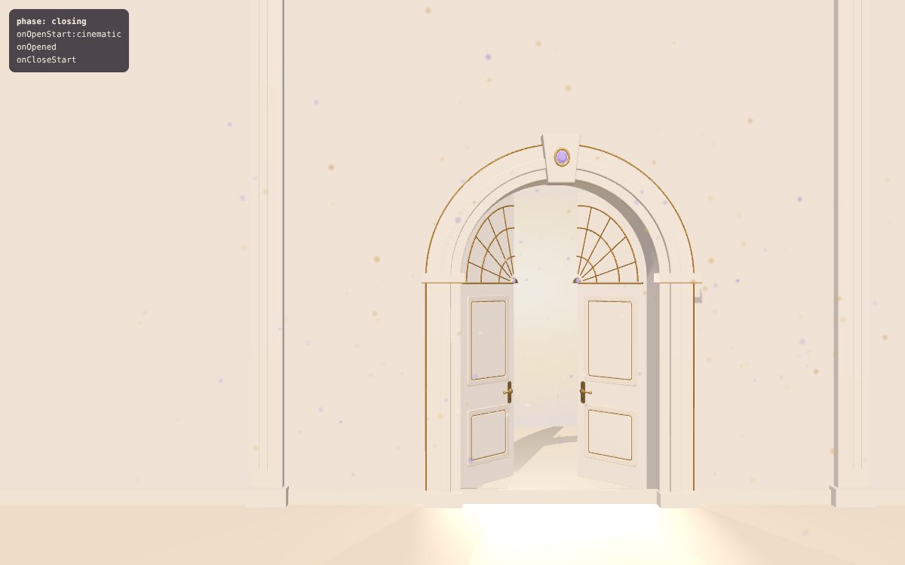
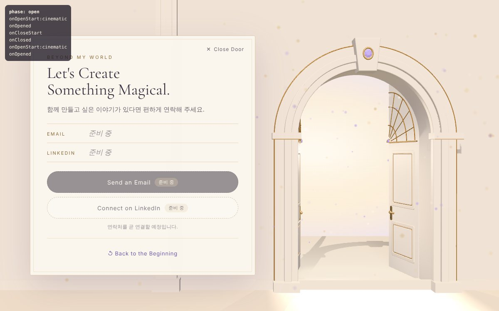
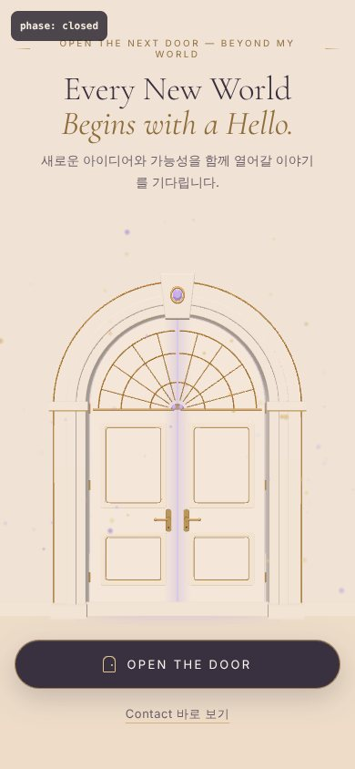
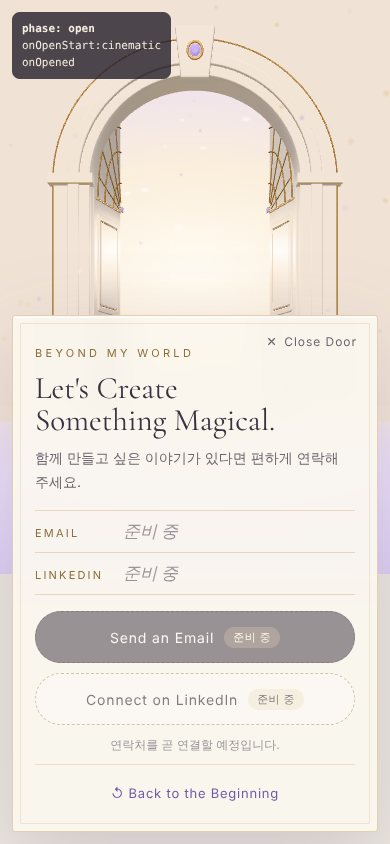

# Contact · Open the Next Door (`src/contact/`)

Unlock My World의 마지막 장면입니다. 방문자가 디자이너의 세계를 둘러본 뒤, 실제 3D 아치형 문을 열면 따뜻한 빛과 함께 연락처가 나타납니다.

Intro의 황금 자물쇠가 "나의 세계를 여는 장면"이라면, 이 문은 "함께 새로운 세계를 여는 장면"입니다. 강렬한 확대·폭발 대신, 조용하고 우아하게 열리는 문과 여운이 남는 빛으로 마무리합니다.

이 폴더는 **독립 모듈**입니다. App.tsx, CameraRig.tsx, ScrollTour.tsx, 전시관·Intro·About·Process·Case Study, 전역 CSS를 import하지도, 수정하지도 않습니다. 외부 3D 모델 없이 Three.js 절차적 지오메트리로 만들었습니다.

## 미리보기

```bash
npm run dev
```

**http://localhost:5173/src/contact/preview/** (기존 앱 `/` 은 그대로)

| 쿼리 | 설명 |
|---|---|
| `?debug` | phase와 이벤트 로그 |
| `?email=...&linkedin=https://...` | 연락처가 연결된 상태를 미리보기 (저장되지 않음) |

전체 인터랙션 영상: [`screenshots/contact-interaction.mp4`](screenshots/contact-interaction.mp4)

| 닫힌 문 | Hover | 열리는 중 | 연락처 |
|---|---|---|---|
|  |  |  |  |
| **닫는 중** | **다시 열기** | **모바일 닫힘** | **모바일 연락처** |
|  |  |  |  |

## 연락처 연결 — `data/links.ts`

```ts
export const CONTACT_LINKS: ContactLinks = {
  email: '',     // 예: 'name@domain.com'
  linkedin: '',  // 예: 'https://www.linkedin.com/in/...'
}
```

- 값이 비어 있거나 형식이 맞지 않으면 버튼은 **'준비 중'**(비활성), 연락처 값도 '준비 중'으로 표시됩니다.
- 값을 넣는 즉시 `Send an Email` → `mailto:`(제목 포함), `Connect on LinkedIn` → 새 탭(`noopener noreferrer`)으로 연결됩니다.
- 컴포넌트에 `links` prop으로 덮어쓸 수도 있습니다.

## 문구 — `data/content.ts`

헤드라인(줄 단위, 두 번째 줄은 이탤릭), 부제, CTA, 연락처 제목·본문, 버튼명, 화면 낭독기 문구까지 모두 여기에 있습니다. `content` prop으로 일부만 덮어쓸 수 있습니다.

## 인터랙션

| 단계 | 연출 |
|---|---|
| Idle | 문은 닫혀 있고, 가운데 문틈과 문턱 아래로 라벤더빛이 숨 쉬듯 새어 나옴. 문 주변에 금빛·라벤더 입자. 마우스를 따라 아주 약한 패럴랙스 |
| Hover | (문 영역 또는 CTA 버튼) 손잡이와 금 테두리에 금빛 하이라이트, 문틈 빛이 밝아짐, 커서가 포인터로 바뀜 |
| 0.05s | 레버 손잡이가 로제트 축을 중심으로 실제로 내려감 |
| 0.42s | 걸쇠가 풀리며 문이 살짝 밀렸다가 숨을 고름. 문틈 빛이 먼저 번짐 |
| 0.8 – 3.1s | 두 문짝이 각자의 힌지 축을 중심으로 안쪽으로 천천히 열림. 문 너머 아이보리·라벤더 세계가 밝아지고, 바닥에 빛이 길게 드리우며, 문 뒤 스포트라이트가 열린 문짝의 그림자를 앞쪽 바닥에 떨어뜨림. 카메라는 문 쪽으로 다가가며 구도를 옮김 |
| 2.5s~ | 열린 문 안쪽 가운데에 연락처 등장 (제목 → 짧은 시간차로 이메일·LinkedIn). 위치는 장면이 문 개구부를 화면에 투영해 CSS 변수(`--cn-open-cx` 등)로 넘기므로 카메라·화면 크기가 바뀌어도 문틀 안에 머묾. 주변 입자가 바깥으로 살며시 흩어지고, 문 너머에서 빛 입자가 천천히 흘러나옴 |
| 닫기 | `Close Door` 버튼 또는 `Esc` → 패널이 물러나고 카메라가 뒤로, 문이 닫히며 '딸깍' 반동 → 초기 상태 |

- **Contact 바로 보기**: 긴 연출 없이 0.5초 만에 열린 상태와 연락처를 표시합니다.
- **prefers-reduced-motion**: 문 열기·닫기 애니메이션 없이 곧바로 상태를 전환합니다.
- 문짝은 벽 뒷면에 달려 안쪽으로 열리므로, 회전하는 동안 아치나 벽을 관통하지 않습니다.
- 클릭 판정은 문과 문틀 전체입니다. 작은 손잡이를 정확히 누를 필요가 없습니다.
- 진행 중 반복 클릭·키 입력은 무시되고, 열고 닫기를 반복해도 이벤트는 동작마다 정확히 한 번씩 발행됩니다.

## 접근성

- `Open the Door` / `Contact 바로 보기`는 실제 버튼입니다 (Tab, Enter/Space).
- 문이 열리면 포커스가 연락처 제목으로 이동하고 "문이 열렸습니다" 안내가 나옵니다. 닫히면 포커스가 CTA로 돌아옵니다.
- 숨겨진 패널은 `visibility:hidden` 상태라 탭 이동과 화면 낭독기에서 제외됩니다.
- 3D 캔버스는 `aria-hidden`입니다. 모든 기능은 HTML 버튼으로 사용할 수 있습니다.
- 터치 영역은 44px 이상, CTA와 연락 버튼은 52–54px입니다.

## 자동 진입 (사이트 통합)

```tsx
<ContactSection autoOpen startSignal={revealed} />
```

`startSignal` 이 true 가 되면(사이트에서는 공간 전환의 빛이 걷히는 순간) 닫힌 문을 0.6초 보여 준 뒤:

1. 위 표의 문 열림 연출을 그대로 재생 (`timeline.ts` 의 공통 함수)
2. 문이 약 85% 열리면 카메라가 문 가운데로 전진 (`anim.pass`) — 문짝과 문틀이 화면 양끝으로 밀려나며 사라짐
3. 문 너머 빛의 하늘에 들어설 즈음 **Contact 전용 화면**(`components/ContactScreen.tsx`)이 같은 색조로 번져 나오고,
   제목 → 소개 → Email · LinkedIn 순서로 나타남
4. 다 나타나면 3D 문 장면은 언마운트 (문은 다시 나타나지 않고 GPU 를 비움)

| 환경 | 동작 |
|---|---|
| 데스크톱 | 전진 1.8초, 문 너머 z=-3.4 까지 |
| 세로 화면 | 전진 1.2초, z=-1.6 까지 (짧고 가볍게) |
| 동작 줄이기 · 3D 미지원 | 이동 없이 Contact 화면을 곧바로 표시 |
| 연출이 끝나지 않는 경우 | 안전 시간 뒤 Contact 화면 표시 |

자동 모드에는 `Open the Door` · `Contact 바로 보기` · `Close Door` · `Esc` 닫기 · `Back to the Beginning` 이 없습니다
(사이트 상단 바의 Back to Gallery 사용). `autoOpen` 을 생략하면 원래의 수동 흐름과 연락처 패널(독립 미리보기)입니다.

## 통합 (추후)

```tsx
import { ContactSection } from './contact'

<ContactSection
  id="contact"
  onBackToBeginning={() => window.scrollTo({ top: 0, behavior: 'smooth' })}
  onOpened={() => {}}
/>
```

| 콜백 | window 이벤트 | 시점 |
|---|---|---|
| `onOpenStart(mode)` | `unlockmyworld:contact-open-start` | 열기 시작 (`cinematic` / `instant`) |
| `onOpened` | `unlockmyworld:contact-opened` | 완전히 열리고 연락처 표시 |
| `onCloseStart` | `unlockmyworld:contact-close-start` | 닫기 시작 |
| `onClosed` | `unlockmyworld:contact-closed` | 초기 상태로 복귀 |
| `onBackToBeginning` | `unlockmyworld:contact-back-to-beginning` | 'Back to the Beginning' (문도 함께 닫힘) |
| `onContactClick(method)` | — | 연락 버튼 클릭 |

- 섹션은 `position: relative; min-height: 100svh`인 일반 블록이라 스크롤 페이지의 마지막에 그대로 둘 수 있습니다.
- 화면 밖에 있을 때는 `IntersectionObserver`로 렌더 루프를 멈춥니다.
- 모바일·터치 기기에서는 그림자 맵을 끄고, 입자 수와 해상도를 줄입니다.

## 구조

```
src/contact/
├── index.ts               공개 API
├── ContactSection.tsx     섹션 컴포넌트 (상태, 포커스, ESC, 이벤트)
├── timeline.ts            열기·닫기 GSAP 타임라인
├── animState.ts           GSAP ↔ useFrame 공유 값
├── events.ts              이벤트 계약
├── components/ContactPanel.tsx   연락처 패널 ('준비 중' 처리)
├── data/content.ts        모든 문구
├── data/links.ts          이메일·LinkedIn (빈 값)
├── scene/
│   ├── DoorScene.tsx      카메라(화면 비율별 구도), 조명, 클릭 판정
│   ├── ArchDoorway.tsx    벽, 계단형 아치 몰딩, 금 테두리, 키스톤과 라벤더 보석, 기둥, 바닥
│   ├── DoorLeaf.tsx       문짝 (패널, 금 상감, 부채꼴 장식, 경첩, 회전하는 레버 손잡이)
│   ├── Beyond.tsx         문 너머 세계, 문틈 빛, 바닥의 빛, 스포트라이트
│   ├── Sparkles.tsx       GPU 마법 입자
│   └── geometry · materials · layout · textures
├── styles/contact.css     .cn-contact 범위 스타일
├── preview/               독립 미리보기
└── screenshots/           캡처와 영상
```
