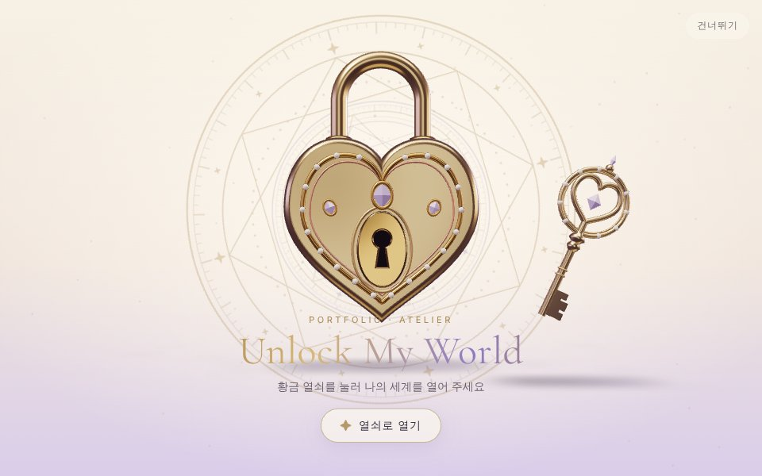
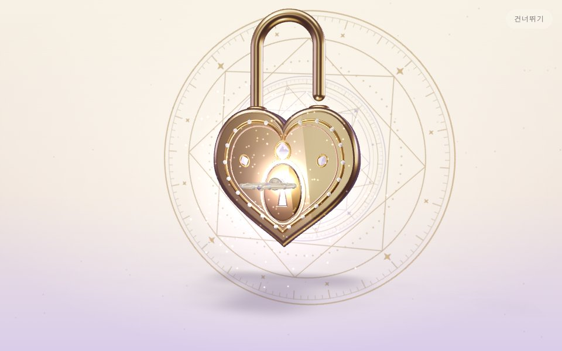
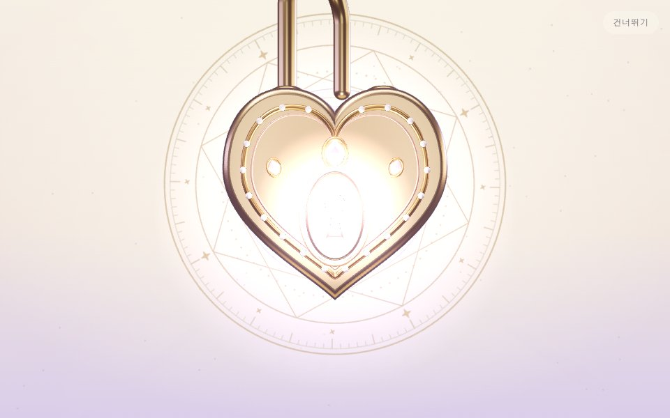
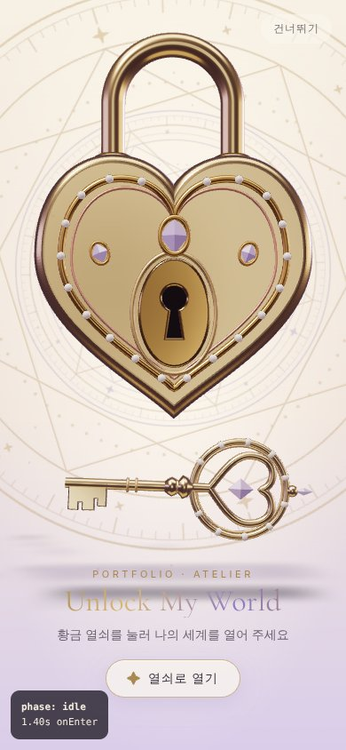

# 황금 자물쇠 Intro (`src/intro/`)

Unlock My World 첫 화면 — 황금 열쇠를 눌러 하트형 황금 자물쇠를 열고, 자물쇠가 카메라 쪽으로 다가와 화면을 채운 뒤 마법의 빛과 함께 전시관으로 넘어가는 인트로입니다.

이 폴더는 **독립 모듈**입니다. 기존 전시관 코드(`App.tsx`, `CameraRig.tsx`, `ScrollTour.tsx`, `src/styles/*` 등)를 import하지도, 수정하지도 않습니다.
외부 모델·HDR 파일 없이 Three.js 절차적 지오메트리만으로 만들었습니다.

## 스크린샷

| 대기 (데스크톱) | 해제 순간 | 확대 → 빛 전환 | 모바일 |
|---|---|---|---|
|  |  |  |  |

## 미리보기

```bash
npm run dev
```

브라우저에서 **http://localhost:5173/src/intro/preview/** 를 엽니다. (기존 앱 `http://localhost:5173/` 은 그대로입니다.)

| 쿼리 | 설명 |
|---|---|
| `?debug` | 이벤트 로그 패널 (phase + 콜백 호출 시각) |
| `?reveal=manual` | 빛이 화면을 덮은 상태에서 멈춤 → "전시관 준비 완료" 버튼으로 걷기 |
| `?slow=0.25` | 해제 시퀀스를 느리게 재생 (연출 점검용) |

예: `http://localhost:5173/src/intro/preview/?debug&slow=0.3`

## 연출 순서

| 시간(초) | 단계 | phase | 이벤트 |
|---|---|---|---|
| 0 | 첫 프레임 렌더, 자물쇠가 숨 쉬듯 흔들리고 열쇠가 떠 있음 | `idle` | `onEnter` |
| 클릭 | 열쇠(또는 "열쇠로 열기" 버튼) 클릭 | `unlocking` | `onUnlockStart` |
| 0 – 1.2 | 열쇠가 포물선으로 날아와 열쇠 구멍 조준, 카메라는 3/4 측면으로 | | |
| 1.2 – 1.7 | 삽입 — 찰칵하는 반동, 열쇠 구멍에서 빛이 새어 나옴 | | |
| 1.95 – 2.55 | 열쇠 90° 회전 | | |
| 2.5 | 걸쇠가 튀어 오르고 빛 입자 폭발, 열쇠는 빛으로 흩어짐 | | `onUnlocked` |
| 2.85 – 3.9 | 걸쇠가 옆으로 열리고 카메라는 정면으로 복귀 | | |
| 3.25 – 4.95 | 자물쇠가 카메라 쪽으로 확대, 빛나는 열쇠 구멍이 화면 중앙을 채움 | `zooming` | |
| 4.45 – 5.05 | 크림·라벤더 빛이 화면을 덮음 | `covered` | `onCovered` |
| 5.4 – 6.6 | 빛이 걷히며 아래 화면이 드러남 | `revealing` → `done` | `onComplete` |

`prefers-reduced-motion` 환경에서는 카메라 이동·확대 없이 짧은 크로스페이드로 대체됩니다.
"건너뛰기" 버튼은 같은 시퀀스를 4배속으로 재생합니다.

## 폴더 구조

```
src/intro/
├── index.ts               공개 API (GoldenLockIntro, IntroGate, INTRO_EVENTS, 타입)
├── GoldenLockIntro.tsx    전체 화면 Intro 컴포넌트 (Canvas + 안내 UI + 빛 오버레이)
├── GoldenLockIntro.css    .gl-intro 범위 스타일 (공통 스타일 미사용)
├── IntroGate.tsx          연결 도우미: <IntroGate><App /></IntroGate>
├── events.ts              진입·완료 이벤트 계약 (props 콜백 + window CustomEvent)
├── animState.ts           GSAP ↔ useFrame 공유 애니메이션 값
├── timeline.ts            열쇠 클릭 이후 GSAP 타임라인
├── scene/
│   ├── IntroScene.tsx     장면 구성, 반응형 카메라, 확대 연출
│   ├── Padlock.tsx        하트형 자물쇠 (베벨 압출 몸체, U자 걸쇠, 열쇠 구멍 장식판, 진주, 보석)
│   ├── GoldenKey.tsx      입체 열쇠 (하트 고리, 진주 원환, 선반 칼라, 이), 클릭 판정
│   ├── MagicEffects.tsx   마법진, 떠다니는 반짝임, 열쇠 구멍 빛, 빛 입자 폭발
│   ├── StudioEnvironment.tsx  라이트포머 기반 반사 환경 (외부 HDR 없음)
│   ├── materials.ts       샴페인 골드, 로즈 골드, 라벤더 보석, 진주 머티리얼
│   ├── geometry.ts        하트, 열쇠 구멍, 걸쇠 경로, 열쇠 이 윤곽
│   ├── textures.ts        캔버스 텍스처 (글로우, 별, 마법진)
│   ├── layout.ts          치수, 열쇠 구멍 좌표
│   └── palette.ts         크림 · 라벤더 · 샴페인 골드
├── preview/               독립 미리보기 (index.html, main.tsx, preview.css)
└── screenshots/           README용 캡처
```

## 전시관에 연결하는 방법 (추후)

### 1) 가장 간단한 방법 — `IntroGate`

```tsx
// main.tsx (나중에 연결할 때)
import { IntroGate } from './intro'

<IntroGate>
  <App />
</IntroGate>
```

빛이 화면을 덮는 순간(`onCovered`) `<App />`을 아래에 마운트하고, 빛이 걷히면(`onComplete`) Intro를 언마운트합니다.

### 2) 직접 제어

```tsx
<GoldenLockIntro
  onEnter={() => {}}
  onUnlockStart={() => {}}
  onUnlocked={() => {}}
  onCovered={() => setShowExhibition(true)} // 이 시점에 전시관 마운트
  onComplete={() => setShowIntro(false)}    // 이후 Intro 언마운트
/>
```

전시관 로딩이 오래 걸리면 `autoReveal={false}`로 두고, 준비가 끝났을 때 `revealSignal={true}`로 바꿔 빛을 걷어 주세요.

### 3) 컴포넌트 결합 없이 — window 이벤트

```ts
import { INTRO_EVENTS } from './intro'
window.addEventListener(INTRO_EVENTS.complete, () => { /* 스크롤 투어 시작 등 */ })
```

| 이벤트 | 이름 |
|---|---|
| 진입 | `unlockmyworld:intro-enter` |
| 해제 시작 | `unlockmyworld:intro-unlock-start` |
| 해제 완료 | `unlockmyworld:intro-unlocked` |
| 화면 덮음 | `unlockmyworld:intro-covered` |
| 완료 | `unlockmyworld:intro-complete` |

> 주의: Intro는 `position: fixed; z-index: 1000` 오버레이입니다. 필요하면 `--gl-intro-z` CSS 변수로 바꿀 수 있습니다.
> 전시관이 `onCovered`에 마운트되면 Intro와 전시관 Canvas 두 개가 잠시 동시에 존재합니다. 빛이 덮은 뒤 Intro 캔버스는 숨겨지고, `onComplete` 후 언마운트됩니다.

## 외부 3D 모델 제안 (선택)

지금 버전은 외부 파일 없이 완성되어 있습니다. 더 정교한 조형이 필요하면 아래 모델로 교체할 수 있습니다. `Padlock.tsx` / `GoldenKey.tsx`만 `useGLTF` 기반으로 바꾸면 되고, 애니메이션 계약(`IntroAnim`)은 그대로 쓸 수 있습니다.

| 모델 | 요구 사항 | 파일 |
|---|---|---|
| **하트형(또는 앤티크) 장식 자물쇠** | 걸쇠(샤클)를 별도 메시로 분리하고 피벗을 왼쪽 다리 축에 둘 것. 몸체, 걸쇠, 열쇠 구멍 장식판, 보석을 메시별로 나눠 머티리얼 교체 가능하게. 열쇠 구멍은 실제로 뚫린 깊이가 있을 것. 20k–40k tris | `public/models/intro/padlock.glb` (Draco 압축) |
| **장식 열쇠 (빅토리안 / 마법 지팡이풍)** | 원점을 열쇠 끝(tip)에, 샤프트는 +Y 방향. 고리(bow), 샤프트, 이(bit)를 분리. 고리에 보석 소켓. 10k–20k tris | `public/models/intro/key.glb` |
| **HDR 환경맵 (선택)** | 따뜻한 스튜디오 소프트박스 계열 1k HDR (예: Poly Haven의 studio 계열, CC0) — 현재 라이트포머 환경 대신 사용 | `public/textures/intro/studio_1k.hdr` |
| **노멀/러프니스 맵 (선택)** | 브러시드 골드 미세 결, 각인 문양(필리그리) 노멀 맵 1k, 타일 가능 | `public/textures/intro/` |

작업 조건: PBR Metal/Rough, 금속 부분은 `metalness=1`, 실측 비율(자물쇠 높이 약 2.6 단위), Y-up, glTF 2.0. Sketchfab의 CC-BY/CC0 모델을 쓸 경우 라이선스와 출처 표기를 확인해야 합니다.
