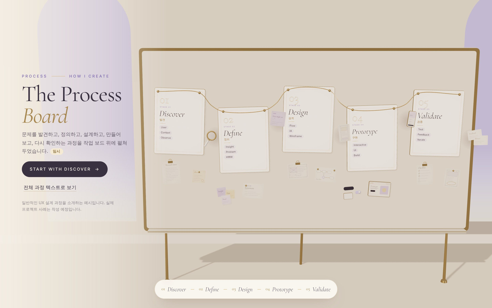
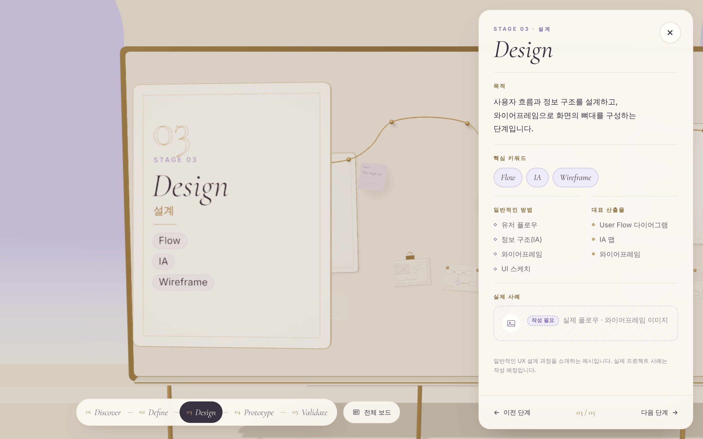
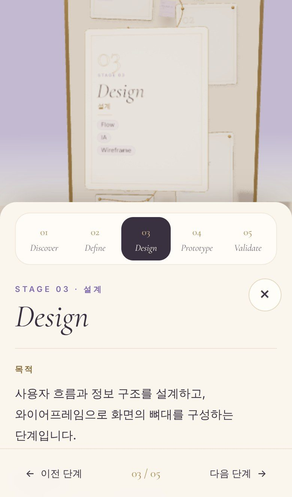

# Process — How I Create / The Process Board

마법적인 아틀리에 속 **디자이너의 작업 보드**입니다. 3D 보드에 붙은 단계 카드와 자료가 그대로 인터페이스가 되어,
카드를 고르면 보드에서 떨어져 나와 앞으로 날아오고, 상세 설명은 읽기 쉬운 HTML 패널로 펼쳐집니다.
전시관 코드(`App.tsx`, `scenes/`, `sections/`, `styles/`)와 분리된 독립 모듈입니다.

| 보드 전체 | 카드 상세 | 모바일 |
|---|---|---|
|  |  |  |

인터랙션 영상: [`docs/process/process-interaction.mp4`](../../docs/process/process-interaction.mp4)

## 미리보기

```bash
npm run dev
# http://localhost:5173/process-preview.html
```

미리보기 페이지까지 포함한 빌드 (기존 `vite.config.ts` 수정 없음):

```bash
npx vite build --config vite.process.config.ts   # dist/process-preview.html
```

## 경험 구성

- **보드 전체**: 다섯 단계 카드가 금색 핀으로 고정되고 얇은 금실로 이어짐. 단계마다 3D 자료(리서치 노트,
  돋보기, 포스트잇, HMW 메모, 와이어프레임, 플로우, 미니 브라우저, 스마트폰, UI 컴포넌트, 체크리스트, 피드백 카드…)가
  붙어 있고, 단계마다 하나씩은 보드 앞에 떠 있음. 금실 위로 아주 천천히 빛이 흐름
- **Hover**: 카드가 보드에서 앞으로 떠오르고(그림자가 멀어짐) 금박 옆면이 은은하게 빛남. 해당 단계 자료도 살짝 반응
- **Click / Tap**: 카드가 보드에서 앞으로 당겨지듯 분리 → 위쪽이 들리며 몸을 틀어 날아와 → 카메라 앞에서 커지며 정면을 향함.
  카메라도 해당 단계 쪽으로 다가가고, 오른쪽(모바일은 아래)에 상세 패널
- **연결 연출**: 선택한 단계에서 다음 단계로 금실 위를 빛이 흐름, 다른 카드는 살짝 어두워짐
- **이동**: 바로가기 메뉴(순서와 무관하게 바로 이동) · 이전/다음 단계 · ← → 키 · 전체 보드 · ✕ · Esc
- 3D 카드에는 단계 이름과 키워드만, 긴 설명은 HTML 패널에만 표시

### 접근성 · 반응형

- 바로가기 메뉴: 현재 단계 `aria-current="step"`, ← → / Home / End 로 버튼 간 이동, 포커스하면 3D 카드도 강조
- 상세가 열리면 제목으로, 닫으면 해당 단계 버튼으로 포커스 이동
- **전체 과정 텍스트로 보기** — 3D 없이 다섯 단계 전체를 HTML 로 (WebGL 미지원 시 자동 표시)
- 좁은 화면(폭 760px 이하 또는 세로 화면): 세로로 긴 모바일 전용 보드 배치(지그재그) + 모바일 전용 카메라,
  3D 아래 큰 5칸 버튼, 카드 선택 시 3D 아래 읽기 시트
- `prefers-reduced-motion`: 카드 분리 · 카메라 이동 없이 즉시 전환, 부유 · 빛 흐름 정지
- 화면 밖에서는 렌더링 정지, three.js 장면은 별도 청크로 지연 로딩, 모바일은 그림자 맵 · 텍스처 해상도 · DPR 축소
- 모든 지오메트리 · 머티리얼 · 캔버스 텍스처는 언마운트 시 해제

## 콘텐츠 수정

모든 텍스트는 `data/processContent.ts` 한 파일에 있습니다. 3D 카드(캔버스 텍스처), 상세 패널, 텍스트 보기가 모두 이 데이터에서 그려집니다.

- `purpose` · `methods` · `deliverables` 는 **일반적인 UX 설계 방법론 설명**이며 개인 이력이 아닙니다.
- 실제 사례 자리 `examples` 는 모두 `pending()` — 화면에 '작성 필요' 표시와 안내가 나타납니다.
- `keywords` 는 3D 카드에 크게 들어가므로 2~3개, 짧게 유지하세요.
- `artifacts` 로 단계별 3D 소품을 고를 수 있고, 세 번째 소품은 보드 앞에 떠 있는 자료로 배치됩니다.

## 폴더 구조

```
src/process/
  index.ts                  공개 API — 메인 앱은 여기서만 import
  ProcessSection.tsx        섹션 (상태 · 키보드 · 포커스 · 레이아웃)
  types.ts                  콘텐츠 스키마 + draft() / pending()
  data/processContent.ts    다섯 단계 콘텐츠
  scene/
    ProcessCanvas.tsx       R3F 캔버스 · 조명 · 장면 구성
    layout.ts               가로 / 세로(모바일) 보드 배치
    Board.tsx               두께 있는 아이보리 보드 · 금 테두리 · 선반 · 이젤 · 방
    StageCard.tsx           단계 카드 (호버 떠오름, 보드에서 분리되어 카메라 앞으로)
    GoldThread.tsx          금실 · 핀 · 흐르는 빛 셰이더
    Artifacts.tsx           단계별 3D 자료 15종
    CameraDirector.tsx      보드 구도 ↔ 단계 구도, 미세 패럴랙스
    art.ts / geometry.ts / materials.ts
  components/               StageNav, StageDetail, ProcessTextView, TextValue
  hooks/useProcessEnv.ts    화면 진입 감지, WebGL 지원 확인
  styles/process.css        .pr-root 범위 스타일 (전역 CSS 변경 없음)
  preview/                  독립 미리보기 진입점
```

## 메인 앱 통합

```tsx
import { ProcessSection } from '@/process'

<ProcessSection id="process" />
```

- 자체 CSS 를 import 하며 모든 스타일이 `.pr-root` 안에 한정됩니다. 기존 코드 중 `@/hooks/useMediaQuery` 만 읽기 전용으로 사용합니다.
- 별도 WebGL 캔버스를 쓰며, 화면 밖이면 렌더링을 멈춰 다른 섹션 캔버스와 동시에 계속 그려지지 않습니다.
- 내비게이션에서 `#process` 로 연결하면 됩니다. `App.tsx` 에 한 줄을 추가하는 작업은 다른 세션 작업을 병합한 뒤에 하는 것이 안전합니다.
